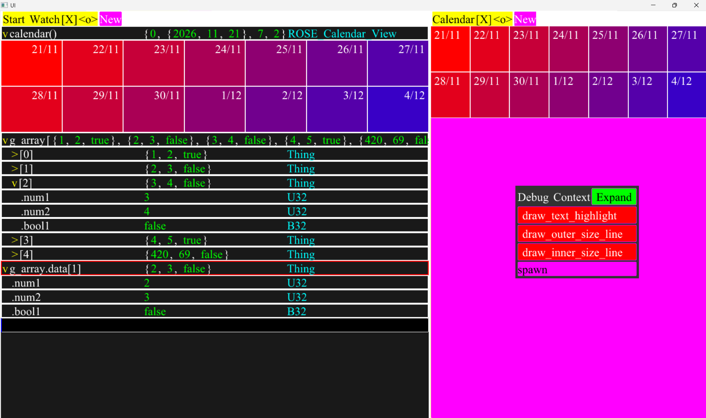

# 🌹 Rose

**Rose** is a scheduler, organizer and event planner — one place for your calendar, your tasks and your notes.

The long-term goal is to replace the usual mix of calendar app + Todoist + Notion with a single tool that understands your time: it should make reorganizing a packed week effortless instead of a chore of dragging every event around by hand.

> **Status:** early development. Most of the work so far has gone into the foundations the app is built on, not the user-facing features yet.



*Two panels side by side: a watch window evaluating `calendar()` and inspecting data, and a calendar view.*

## Highlights

- **Built from scratch.** Written in C with no frameworks — platform layer, windowing, OpenGL rendering (plus a very basic experimental Vulkan backend), font rendering and UI are all custom.
- **Expression evaluator.** Rose has its own expression language for querying the app's data — events, days, dates — so views and filters can be defined dynamically, e.g. `filter(events, now().date)` for "today".
- **Dynamic UI.** Views are driven by evaluated expressions, so the interface can be reshaped by what you ask it to show rather than by fixed screens.
- **Panel system.** A flexible, tiling panel layout for arranging calendars, lists and inspectors side by side.

## Project layout

```
code/
  base/      core library: memory arenas, strings, math, time, OS layer
  gfx/       windowing + rendering (OpenGL; minimal Vulkan experiment; Win32, Linux)
  fnt/       font loading and rasterization
  ui/        immediate-mode UI core and basic widgets
  token/     tokenizer
  ast/       expression parser / syntax tree
  ir/        expression IR
  rose/      the Rose app itself: events, evaluation, serialization, widgets
  examples/  small test programs for individual layers
  builder.c  the project's build tool
data/        fonts and test images
docs/        development notes and TODO list
```

## Building

Rose currently targets **Windows** with **MSVC**. From a Developer Command Prompt:

```
cd code
build.bat
```

`build.bat` first compiles the custom build tool (`builder.c`) and then uses it to build the target.

## Roadmap

Ideas, design notes and the current TODO list live in [docs/NOTES.md](docs/NOTES.md).

## License

Rose is released under the [MIT License](LICENSE).
